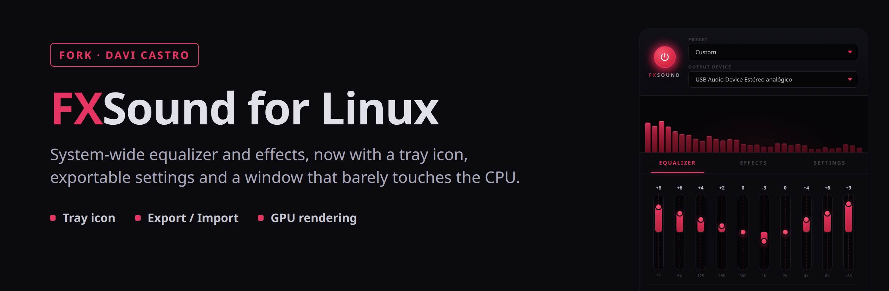
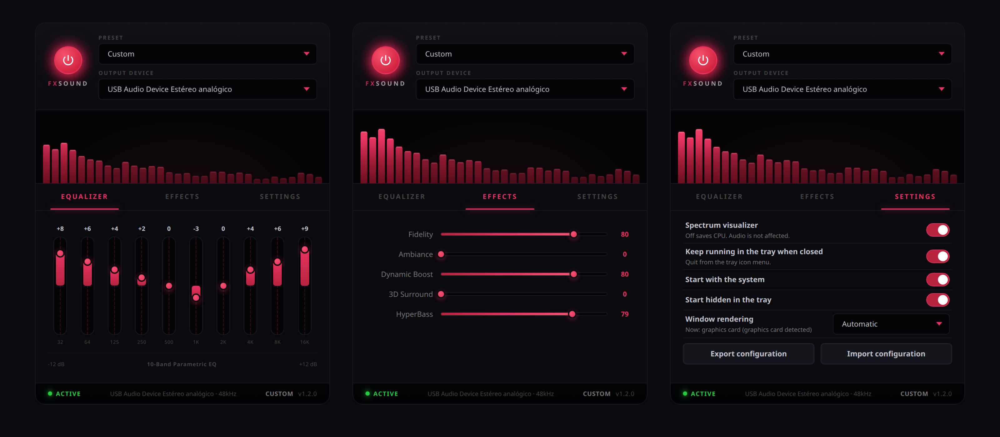

<p align="center">
  
</p>

<p align="center">
  <a href="https://github.com/Raul909/FXSound_For_Linux"></a>
  
  
  
  
  
</p>

<p align="center"><a href="README.md">Português</a> | <strong>English</strong></p>

# FXSound for Linux (fork)

A 10-band equalizer and effects (Fidelity, Ambiance, Dynamic Boost, 3D Surround and HyperBass)
applied to **all system audio**, in the style of FxSound on Windows. It works with PipeWire and
PulseAudio: it adds an **FXSound** output, applications play into it and the result goes to your
headphones or speakers.

This repository is a **fork** of [Raul909/FXSound_For_Linux](https://github.com/Raul909/FXSound_For_Linux).
The original sounds great, but in my use it kept **a CPU core busy all the time** just drawing
the window, had no tray icon (closing the window turned the effect off) and offered no way to save
the configuration or take it to another PC. This fork fixes that, as explained below.

<p align="center">
  
</p>

<p align="center"><sub>Equalizer · Effects · Settings (new in this fork)</sub></p>

---

## What this fork changes

| Problem in the original | Cause | What this fork does |
|---|---|---|
| The window used **70–90% of a CPU core**, even when idle | The app forces `LIBGL_ALWAYS_SOFTWARE=1` on every machine (so it never breaks in a VM), so the whole window is drawn by the CPU | Decides at launch: uses the **GPU** where it works (Mesa + X11, not a VM, no NVIDIA driver, not Wayland) and software elsewhere. The reason is shown in Settings |
| If the GPU path fails, the app never opens, so the option cannot even be changed | The failure (`EGL_BAD_PARAMETER`) kills WebKitGTK before the window exists | Every GPU launch leaves a marker that is removed once the window loads. If a launch dies before that, the next one falls back to software by itself and **remembers the failure** until the option is changed, so it never loops between opening and crashing |
| Even on the GPU, the idle window cost ~24% | The power button and "ACTIVE" dot glows animate `box-shadow`, which repaints the window 60 times a second, and the DMABUF renderer was disabled | The same glow now pulses through the **opacity** of a layer (compositor work) and DMABUF stays on in GPU mode. Looks identical |
| The visualizer kept working while minimized or covered | The draw loop and the engine polling never stopped | With the window hidden or minimized the visualizer **stops completely**. When visible it draws at 30 fps (data arrives at 20 Hz, so it looks the same) and it can be switched off |
| Closing the window turned the effect off | No tray icon | **Tray icon** with Show, Hide, Effects on/off and Quit. Closing the window keeps FXSound running. Without a tray on the desktop, closing quits as before |
| No way to save or move the configuration | Only the internal settings file existed | **Export and import** as JSON. The output device is left out, because its name belongs to one machine. Files from other programs are rejected and out-of-range values are clamped |
| The app had to be started by hand on every login | No autostart | **Start with the system**, optionally hidden in the tray. Works with the AppImage |

### Measured cost (WebKitWebProcess, % of one core)

| Situation | Original | This fork |
|---|---|---|
| Window open, idle | 70 – 90% | **3 – 6%** |
| Window minimized | not measured | **0%** |
| Window hidden in the tray | (closing quit the app) | **0%**, effect still on |

Tested on: Linux Mint 22.3 (kernel 7.0), Cinnamon on X11, PipeWire 1.0.5, AMD Ryzen 5700G
(Radeon Vega, Mesa) and a USB headset. The software fallback was tested by simulating a launch that
never reached the window. Wayland and NVIDIA stay on the safe (software) path, as in the original.

---

## Usage

### The Settings tab

| Option | What it does |
|---|---|
| **Spectrum visualizer** | Turns the bars on or off. Off costs nothing; the sound is not affected |
| **Keep running in the tray when closed** | Closing the window keeps FXSound in the tray, effect on. To quit, use **Quit FXSound** in the tray menu |
| **Start with the system** | Starts FXSound with the session (creates `~/.config/autostart/fxsound-linux.desktop`) |
| **Start hidden in the tray** | When started with the session, stay in the tray |
| **Window rendering** | `Automatic` (recommended), `Graphics card (GPU)` or `Processor (software)`. Shows what is in use and why. Applies from the next launch |
| **Export configuration** | Saves EQ, effects, preset and these options to a `.json` |
| **Import configuration** | Loads an exported `.json`. The current output device is kept |

### The tray icon

| Item | What it does |
|---|---|
| Show FXSound | Shows the window |
| Hide to tray | Hides the window; the effect keeps running |
| Effects on | Turns the effect on or off, in sync with the window's power button |
| Quit FXSound | Quits and hands system audio back to the normal output |

Launching FXSound while it is already running brings its window back instead of starting a second copy.

---

## Installation

### 1. Dependencies

Debian, Ubuntu, Linux Mint and derivatives:

```bash
sudo apt install -y build-essential pkg-config libssl-dev file \
  libwebkit2gtk-4.1-dev libgtk-3-dev librsvg2-dev libpulse-dev libayatana-appindicator3-dev
curl --proto '=https' --tlsv1.2 -sSf https://sh.rustup.rs | sh
```

Node.js 20 or newer is also needed. Fedora and Arch: see the equivalent packages in [GUIDE.md](GUIDE.md).

### 2. Download and build

```bash
git clone https://github.com/Davicjc/FXSound_For_Linux.git
cd FXSound_For_Linux
npm ci
npm run tauri build -- --bundles appimage,deb
```

The packages end up in `src-tauri/target/release/bundle/`:

- `appimage/fxsound-linux_1.2.0_amd64.AppImage`: runs without installing. Copy it anywhere and `chmod +x` it.
- `deb/fxsound-linux_1.2.0_amd64.deb`: `sudo apt install ./fxsound-linux_1.2.0_amd64.deb`.

### 3. First run

Open FXSound, set the equalizer and effects and, if you like, turn on **Start with the system** in
Settings. Everything is saved automatically to `~/.config/com.fxsound.linux/settings.json`.

---

## Uninstalling

```bash
rm ~/path/to/fxsound-linux_1.2.0_amd64.AppImage    # or: sudo apt remove fxsound-linux
rm -f ~/.config/autostart/fxsound-linux.desktop
rm -rf ~/.config/com.fxsound.linux                 # settings (optional)
```

---

## Known limitations

- **Keep the system volume at or below 100%.** Above that the signal clips after the limiter and
  distorts, the bass especially.
- **Wayland and NVIDIA** stay on software rendering in Automatic, since that is where the original
  recorded GPU failures. `Graphics card (GPU)` can be forced; if it fails, the app falls back to
  software by itself on the next launch.
- **`LIBGL_ALWAYS_SOFTWARE`** set in the environment overrides everything (`1` = software,
  `0` = GPU), as in the original.
- **Don't kill the AppImage with `pkill -f` on its path.** That takes down the AppImage mount
  first and leaves the app stuck without its own files. Use **Quit** in the tray, or `kill` only
  the `fxsound-linux` process.

---

## For developers

| File | Contents |
|---|---|
| `src-tauri/src/graphics.rs` | GPU/software choice and the failed-launch guard (new) |
| `src-tauri/src/lib.rs` | Tauri commands, tray, close-to-tray, export/import |
| `src-tauri/src/settings.rs` | Saved settings, window options and the export format |
| `src-tauri/src/audio.rs`, `pulse.rs` | Audio engine and routing (unchanged) |
| `src/components/SettingsPanel.jsx` | The Settings tab (new) |
| `src/components/Visualizer.jsx` | Visualizer, now stopping when the window is not visible |

```bash
cd src-tauri && cargo test && cargo clippy --all-targets && cargo fmt --check
cd .. && npm run lint
npm run tauri dev    # development mode
```

The Rust tests cover the renderer choice, the failure guard and the export/import format
(37 tests). UI strings and code comments stay in English, as in the original project, so the
changes remain easy to compare and to send upstream.

---

## Credits and license

- [Raul909](https://github.com/Raul909/FXSound_For_Linux): the original FXSound for Linux
  (audio engine, PipeWire/PulseAudio routing and the UI).
- [FxSound](https://www.fxsound.com/): the Windows app that inspired the project. Not affiliated.
- Davi Castro: this fork: GPU rendering with the failure guard, tray, autostart, export/import
  and the lower window cost.

MIT License, same as the original (see `LICENSE`). Change history in [CHANGELOG.md](CHANGELOG.md).
