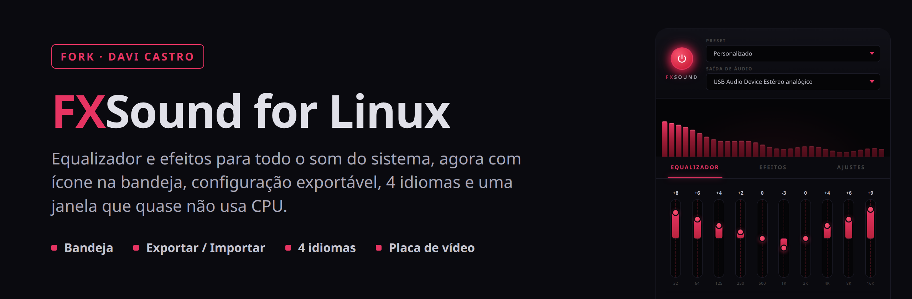
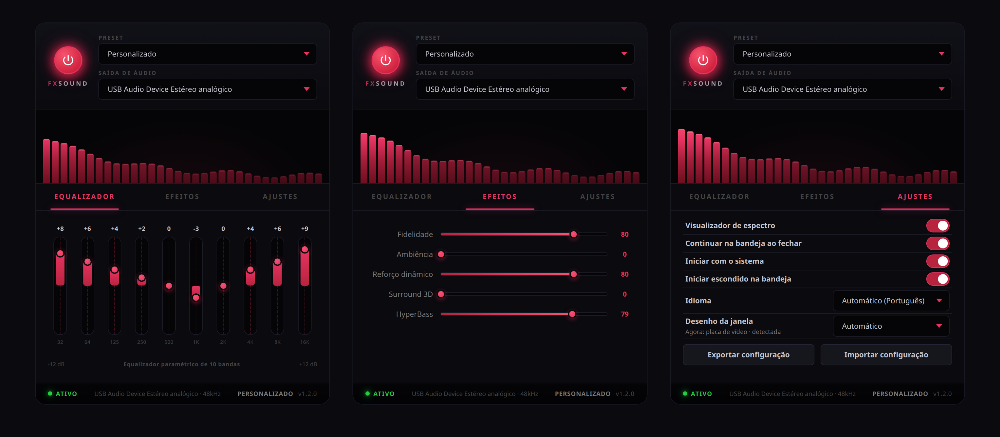

<p align="center">
  
</p>

<p align="center">
  <a href="https://github.com/Raul909/FXSound_For_Linux"></a>
  
  
  
  
  
</p>

<p align="center"><strong>Português</strong> | <a href="README.en.md">Read in English</a></p>

# FXSound for Linux (fork)

Equalizador de 10 bandas e efeitos (Fidelity, Ambiance, Dynamic Boost, 3D Surround e HyperBass)
aplicados em **todo o som do sistema**, no estilo do FxSound do Windows. Funciona com PipeWire e
PulseAudio: cria uma saída **FXSound**, os programas tocam nela e o resultado vai para o seu fone
ou caixa de som.

Este repositório é um **fork** do [Raul909/FXSound_For_Linux](https://github.com/Raul909/FXSound_For_Linux).
O original funciona bem para o som, mas no meu uso ele ficava com **um núcleo do processador
ocupado o tempo todo** só para desenhar a janela, não tinha ícone na bandeja (fechar a janela
desligava o efeito) e não dava para salvar ou levar a configuração para outro PC. Este fork
resolve isso. O que mudou está explicado abaixo.

<p align="center">
  
</p>

<p align="center"><sub>Equalizador · Efeitos · Ajustes (aba nova deste fork), já em português</sub></p>

---

## O que este fork muda em relação ao original

| Problema no original | Causa | O que este fork faz |
|---|---|---|
| A janela ocupava **70 a 90% de um núcleo** do processador, mesmo parada | O app força `LIBGL_ALWAYS_SOFTWARE=1` em todo PC (para não quebrar em máquina virtual), então a tela inteira é desenhada pelo processador, sem placa de vídeo | Decide na abertura: usa a **placa de vídeo** onde ela funciona (Mesa + X11, fora de VM, sem driver NVIDIA, fora do Wayland) e o processador nos outros casos. O motivo aparece na aba Ajustes |
| Se a placa de vídeo falhar, o app não abre e você não consegue nem trocar a opção | O erro (`EGL_BAD_PARAMETER`) derruba o WebKitGTK antes de a janela existir | Cada abertura pela placa de vídeo deixa uma marca, apagada quando a janela carrega. Se a abertura morre antes disso, a próxima usa o processador sozinha e **guarda a falha** até você trocar a opção, para não ficar abrindo e travando em loop |
| Mesmo usando a placa de vídeo, a janela parada gastava ~24% | O brilho do botão de power e do ponto "ACTIVE" anima o `box-shadow`, que obriga a redesenhar a janela 60 vezes por segundo, e o renderizador DMABUF ficava desligado | O mesmo brilho agora pulsa pela **opacidade** de uma camada (trabalho do compositor) e o DMABUF fica ligado no modo placa de vídeo. Visual idêntico |
| O visualizador continuava trabalhando com a janela minimizada ou atrás de outras | O laço de desenho e a consulta ao motor de áudio nunca paravam | Com a janela escondida ou minimizada, o visualizador **para por completo**. Visível, desenha a 30 fps (os dados chegam a 20 Hz, então fica igual) e tem botão para desligar |
| Fechar a janela desligava o efeito | Não havia ícone na bandeja | **Ícone na bandeja** com Show, Hide, Effects on/off e Quit. Fechar a janela deixa o FXSound rodando. Se o desktop não tiver bandeja, fechar sai como antes |
| Não dava para salvar nem levar a configuração | Só existia o arquivo interno de configurações | **Exportar e importar** em JSON. O dispositivo de saída fica de fora, porque o nome dele é de cada PC. Arquivo de outro programa é recusado e valores fora da faixa são corrigidos |
| Precisava abrir o app à mão a cada login | Sem início automático | **Iniciar com o sistema**, com a opção de já começar escondido na bandeja. Funciona com o AppImage |
| Tudo só em inglês | A interface tinha os textos fixos | **4 idiomas: português, inglês, espanhol e chinês (simplificado)**, na janela, no menu da bandeja e nas janelas de abrir e salvar. No automático segue o idioma do sistema (`LC_ALL`, `LC_MESSAGES`, `LANG`) |

### Consumo medido (WebKitWebProcess, % de um núcleo)

| Situação | Original | Este fork |
|---|---|---|
| Janela aberta, parada | 70 – 90% | **3 – 6%** |
| Janela minimizada | não medido | **0%** |
| Janela escondida na bandeja | (fechava o app) | **0%**, com o efeito ativo |

Testado em: Linux Mint 22.3 (kernel 7.0), Cinnamon em X11, PipeWire 1.0.5, AMD Ryzen 5700G
(Radeon Vega, Mesa) e fone USB. A queda para o processador foi testada simulando uma abertura que
não chegou na janela. Wayland e NVIDIA seguem no caminho seguro (processador), como no original.

---

## Como usar

### A aba Ajustes

| Opção | O que faz |
|---|---|
| **Visualizador de espectro** | Liga ou desliga as barras. Desligado, não gasta nada. O som não muda |
| **Continuar na bandeja ao fechar** | Fechar a janela deixa o FXSound na bandeja, com o efeito funcionando. Para sair de vez, use **Sair do FXSound** no menu do ícone |
| **Iniciar com o sistema** | Abre o FXSound ao entrar na sessão (cria `~/.config/autostart/fxsound-linux.desktop`) |
| **Iniciar escondido na bandeja** | Quando ele abre junto com o sistema, já fica só na bandeja |
| **Idioma** | `Automático` (segue o sistema), English, Português, Español ou 中文. Muda na hora, inclusive o menu da bandeja |
| **Desenho da janela** | `Automático` (recomendado), `Placa de vídeo (GPU)` ou `Processador (software)`. Mostra o que está em uso e por quê. Vale a partir da próxima abertura |
| **Exportar configuração** | Salva EQ, efeitos, preset e estas opções num `.json` |
| **Importar configuração** | Carrega um `.json` exportado. A saída de áudio atual é mantida |

### O ícone da bandeja

| Item | O que faz |
|---|---|
| Mostrar FXSound | Mostra a janela |
| Esconder na bandeja | Esconde a janela; o efeito continua |
| Efeitos ligados | Liga ou desliga o efeito, sincronizado com o botão de power da janela |
| Sair do FXSound | Sai e devolve o som do sistema para a saída normal |

Abrir o FXSound pelo menu com ele já rodando traz a janela de volta, sem abrir uma segunda cópia.

---

## Instalação

### 1. Dependências

Debian, Ubuntu, Linux Mint e derivados:

```bash
sudo apt install -y build-essential pkg-config libssl-dev file \
  libwebkit2gtk-4.1-dev libgtk-3-dev librsvg2-dev libpulse-dev libayatana-appindicator3-dev
curl --proto '=https' --tlsv1.2 -sSf https://sh.rustup.rs | sh
```

Também precisa do Node.js 20 ou mais novo. Fedora e Arch: veja os pacotes equivalentes no
[GUIDE.md](GUIDE.md).

### 2. Baixar e compilar

```bash
git clone https://github.com/Davicjc/FXSound_For_Linux.git
cd FXSound_For_Linux
npm ci
npm run tauri build -- --bundles appimage,deb
```

Os pacotes ficam em `src-tauri/target/release/bundle/`:

- `appimage/fxsound-linux_1.2.0_amd64.AppImage`: roda sem instalar. Copie para onde quiser
  (eu uso `~/Aplicativos/`) e dê `chmod +x`.
- `deb/fxsound-linux_1.2.0_amd64.deb`: `sudo apt install ./fxsound-linux_1.2.0_amd64.deb`.

### 3. Primeiro uso

Abra o FXSound, ajuste o equalizador e os efeitos e, se quiser, ligue **Iniciar com o sistema** na
aba Ajustes. O app guarda tudo sozinho em `~/.config/com.fxsound.linux/settings.json`.

---

## Desinstalação

```bash
rm ~/Aplicativos/fxsound-linux_1.2.0_amd64.AppImage    # ou: sudo apt remove fxsound-linux
rm -f ~/.config/autostart/fxsound-linux.desktop
rm -rf ~/.config/com.fxsound.linux                      # configurações (opcional)
```

---

## Limitações e avisos conhecidos

- **Deixe o volume do sistema em até 100%.** Acima disso o sinal estoura depois do limitador e
  distorce, principalmente o grave.
- **Wayland e NVIDIA** ficam no modo processador no automático, porque foi onde o original
  registrou falhas da placa de vídeo. Dá para forçar `Placa de vídeo (GPU)`; se falhar, o app volta
  sozinho para o processador na abertura seguinte.
- **`LIBGL_ALWAYS_SOFTWARE`** definido no ambiente passa por cima de tudo (`1` = processador,
  `0` = placa de vídeo), como no original.
- **Não mate o processo do AppImage com `pkill -f` pelo caminho do arquivo.** Isso derruba
  primeiro o montador do AppImage, e o app fica travado sem os próprios arquivos. Feche pelo
  **Sair do FXSound** da bandeja, ou mande `kill` só no processo `fxsound-linux`.
- **Chinês**: as traduções são em chinês simplificado; `zh_TW` também cai nele.

---

## Para quem for mexer no código

| Arquivo | O que tem |
|---|---|
| `src-tauri/src/graphics.rs` | Escolha GPU/processador e a proteção contra abertura que falha (novo) |
| `src-tauri/src/lib.rs` | Comandos do Tauri, bandeja, fechar para a bandeja, exportar/importar |
| `src-tauri/src/settings.rs` | Configurações salvas, opções da janela e o formato de exportação |
| `src-tauri/src/audio.rs`, `pulse.rs` | Motor de áudio e roteamento (iguais ao original) |
| `src/components/SettingsPanel.jsx` | A aba Ajustes (novo) |
| `src/i18n.js`, `src-tauri/src/i18n.rs` | Textos dos 4 idiomas da janela e da bandeja/diálogos (novo) |
| `src/components/Visualizer.jsx` | Visualizador, agora parando quando a janela não está visível |

```bash
cd src-tauri && cargo test && cargo clippy --all-targets && cargo fmt --check
cd .. && npm run lint
npm run tauri dev    # roda em modo de desenvolvimento
```

Os testes do Rust cobrem a escolha do renderizador, a proteção contra falha, o formato de
exportação/importação e a detecção de idioma (41 testes). Para adicionar um idioma, inclua a
tabela em `src/i18n.js` e em `src-tauri/src/i18n.rs` e o código em `SUPPORTED`. Os comentários do
código seguem em inglês, como no projeto original, para que as mudanças continuem fáceis de
comparar e de devolver ao autor.

---

## Créditos e licença

- [Raul909](https://github.com/Raul909/FXSound_For_Linux): o FXSound for Linux original
  (motor de áudio, roteamento PipeWire/PulseAudio e a interface).
- [FxSound](https://www.fxsound.com/): o programa do Windows que inspirou o projeto. Não há
  ligação oficial.
- Davi Castro: este fork, com a renderização pela placa de vídeo e a proteção contra falha,
  bandeja, início automático, exportar/importar, os 4 idiomas e a redução de consumo da janela.

Licença MIT, igual ao original (veja `LICENSE`). Histórico de mudanças em [CHANGELOG.md](CHANGELOG.md).
